# Temper redesign implementation blueprint

Date 2026-10-28. Trunk 2db47c2c ("Raise the debug live version to 130 (#556)", 2026-10-20). Source: v3 redesign (approved). No code was changed.

Conventions: paths are relative to app/src/main/java/com/sinura/personaltrainer/ unless they start with app/ or tools/. NEW marks files or tests that do not exist yet. INFERRED marks facts read from code but not run. ASSUMPTION marks guesses. Values like 62.5 kg are example data.

## 1. Scope, non-goals, decisions

Scope: the 18 v3 screens, shared components, tokens, two state machines, six packets.

Non-goals: TalkBack work; cloud sync (deferred); data model migrations (none needed; any found must be flagged); changes to the signer and Obtainium release flow; supersets; per-side logging; automatic warm-ups.

| Id | Decision | Recommended default |
|---|---|---|
| D1 | Prefill effort from the last working set of this lift? | Yes, shown as a dotted prefill that counts as chosen when Log is tapped. Today rpe is never prefilled (prefill() in ActiveWorkoutViewModel.kt). |
| D2 | Keep effort required for working sets? | Yes. Keep SetLogRules.requiresEffort. D1 removes the friction. |
| D3 | Where does Finish live? | Overflow at all times, and as the primary after the last planned set of the last lift. |
| D4 | Rest primary colour | RestCyan fill with Pit text (11.33:1). Volt is kept for acting on a set. |
| D5 | When does the Tempo sheet open by itself? | Only during rest, and only when the tip changes weight or reps of the next set. Otherwise TempoLine only. |
| D6 | Show the pre-workout preview? | Yes, by default. A setting "Skip preview" is out of scope. |
| D7 | Navigation order and names | Keep the current order; rename Home to Today. |
| D8 | Move copy to strings.xml? | Yes, for every screen a packet touches, using the ids in this blueprint. Today only 19 strings exist. |
| D9 | Generate warm-ups automatically? | No. Show warm-ups only where the plan has them; applyWarmupRamp stays as is. |
| D10 | Does rest keep running between lifts? | Yes; the mini ring shows on Between lifts. |
| D11 | Tempo next-time card on Summary | Only when progression shows a change. |
| D12 | Cardio Pause and Finish | Finish enabled after 60 s. Pause ships only if it needs no data model change; else defer. |
| D13 | First-time rest caption storage | A DataStore counter (settings), shown for the first 3 sessions. No Room change. |
| D14 | Reorder in Plan day | Keep the existing reorder (sortOrder exists); restyle only. |

## 2. Design tokens

### Colours

| Token | Hex | Status | Use | Contrast (WCAG AA 4.5 body, 3.0 large) |
|---|---|---|---|---|
| Pit | #07090B | Existing | Screen background | n/a |
| Surface1 | #0E1215 | Existing | Cards | n/a |
| Surface2 | #14191D | Existing | Sheets, inset rows | n/a |
| Surface3 | #1B2126 | Existing | Secondary buttons, stepper buttons | n/a |
| SurfacePressed | #232A30 | Existing | Pressed state for surfaces | n/a |
| OutlineSolidVariant | #1E2429 | Existing | Card outline | n/a |
| TextPrimary | #F2F5F7 | Existing | Main text | 18.22 on Pit, 16.16 on Surface2. AA pass |
| TextSecondary | #9BA7AE | Existing | Labels | 8.10 on Pit, 7.19 on Surface2. AA pass |
| TextTertiary | #7F8B93 | Existing | Hints, muted | 5.71 on Pit, 5.07 on Surface2. AA pass |
| TextDisabled | #5F6B73 | Existing | Disabled only | 3.64 on Pit. Fails AA body; allowed for disabled controls (WCAG exempts inactive UI) |
| Volt | #C2FF44 | Existing | Act now: primary fill, selection | Pit text on Volt 16.79. AA pass |
| VoltContainer | #212B13 | Existing | Selected chip, done pill | Volt on it 12.45. AA pass |
| RestCyan | #33D6E8 | Existing | Resting state only | Pit text on RestCyan 11.33; RestCyan on Surface2 10.05. AA pass |
| RestContainer (NEW) | #0B2A2F | New | Rest pill and up-next accent background | RestCyan on it 8.60. AA pass |
| PrGold | #FFC53D | Existing | Records only | 9.67 on GoldContainer. AA pass |
| GoldContainer | #2E2410 | Existing | PR card | n/a |
| Danger | #FF6B6B | Existing | Destructive only | 7.19 on Pit, 6.33 on DangerContainer. AA pass |
| DangerContainer | #2A1214 | Existing | Destructive confirm | n/a |
| Warn | #FFB020 | Existing | Save warnings, rest overtime | not measured here |

Code: ui/theme/Color.kt. New token RestContainer goes in Color.kt.

### Type (ui/theme/Type.kt, InstrumentType)

| Token | Font and weight | Size sp | Line height sp | Use |
|---|---|---|---|---|
| numeralHero | SpaceGrotesk Medium | 76 | 80 | Live weight and reps |
| numeralXl | SpaceGrotesk Medium | 56 | 60 | Rest ring time, target steppers |
| numeralLg | SpaceGrotesk Medium | 36 | 40 | Up next target, summary stats |
| numeralMd | SpaceGrotesk Medium | 24 | 28 | Set pill values (wide) |
| numeralSm | SpaceGrotesk Medium | 17 | 20 | Set pill values |
| display | SpaceGrotesk Bold | 28 | 32 | Screen H1 |
| heroTitle | Inter SemiBold | 24 | 28 | Sheet titles, lift name |
| commit | Inter SemiBold | 20 | 24 | Primary button label |
| workoutTitle | Inter Medium | 20 | 24 | Top bar title |
| title | Inter SemiBold | 16 | 20 | Card and row titles |
| body | Inter Normal | 14 | 20 | Body |
| bodyStrong | Inter Medium | 14 | 20 | Secondary button label |
| caption | Inter Normal | 12 | 16 | Hints, plate line, button sub-label |
| kicker | Inter SemiBold | 11 | 13 | Caps kickers, tracking 0.88sp |
| unit | Inter Medium | 13 | 16 | kg and reps units |

### Spacing and sizes (ui/theme/Metrics.kt)

| Token | Value |
|---|---|
| space1 | 4dp |
| space2 | 8dp |
| space3 | 12dp |
| space4 | 16dp, edge margin (Metrics.gutter) |
| space5 | 20dp |
| space6 | 24dp |
| space7 | 32dp |
| space8 | 40dp |
| sectionGap | 28dp |
| touchMin | 48dp, every tappable |
| control | 56dp, chips and stepper buttons |
| rowMin | 56dp |

### Radii (ui/theme/Shape.kt)

| Token | Value | Use |
|---|---|---|
| Radius.xs | 8dp | set pills |
| Radius.sm | 12dp | chips, inputs |
| Radius.md | 16dp | buttons |
| Radius.lg | 24dp | cards, sheet top corners |
| Radius.full | circle | stepper buttons, ring |

Elevation: none. Depth comes from Surface1 to Surface3 steps and 1dp outlines (checker shadow baseline 0, defaults_elevation 1).

### Motion (ui/theme/Motion.kt)

| Token | Value | Use |
|---|---|---|
| Motion.TAP | 90ms | press feedback |
| Motion.FAST | 150ms | chip select, pill state change |
| Motion.BASE | 240ms | sheet open, set to rest state swap |
| Motion.DRAW | 650ms | ring first draw, PR reveal |
| Motion.TICK_MS | 1000ms | rest tick |
| Motion.STATUS_DWELL_MS | 6000ms | undo window base, scaled by system accessibility timeout (UndoFeedback.kt) |
| Easing | Motion.Standard (0.2,0,0,1) enter; Motion.Exit (0.3,0,1,1) leave | all |
| Reduced motion | LocalReducedMotion: cross-fade only, no ring sweep animation | all |

### Haptics (ui/theme/Haptics.kt)

| Event | Haptic | Status |
|---|---|---|
| Stepper step | Haptics.tick, tickLight on repeat | existing in StepperButton.kt |
| Effort chip select | Haptics.tick | new call site |
| Log set saved | Haptics.commit | existing in ActiveWorkoutScreen.kt |
| Save rejected or invalid | Haptics.reject | existing |
| Rest last 3 seconds | Haptics.warn | existing |
| Rest done | Haptics.holdDone | existing |
| PR logged | Haptics.recordAccent | existing |
| Workout finished | Haptics.commit | existing |
| Tempo suggestion used | Haptics.tick | new call site |

Minimum touch target 48dp everywhere (Metrics.touchMin).

## 3. Components

### PrimaryButton

- Reuse or replace: Replace styling of PrimaryGymButton (components/GymButtons.kt)
- Anatomy: Height 64dp (72dp with sub-label). Full width minus 16dp margins. Radius 16dp. Label commit 20sp Pit on Volt. Optional sub-label caption 12sp, 1 line. Rest variant: RestCyan fill.
- States: Default Volt. Pressed: 8 percent Pit overlay, scale 0.98, Motion.TAP. Disabled: Surface3 fill, TextDisabled label. Loading: label kept, 20dp spinner replaces sub-label, not tappable. Error: label "Retry save", 1dp Danger outline. Selected: n/a.
- Font scale: 1.0: 1 line label, 1 line sub. 1.3: height grows, label max 2 lines. 2.0: sub-label hidden, label max 2 lines. Never truncate the label verb.
- Content rules: Label is a verb phrase, max 24 characters. Sub-label says what happens next, max 40 characters.
- Signature: `fun PrimaryButton(label: String, onClick: () -> Unit, modifier: Modifier = Modifier, subLabel: String? = null, tone: ActionTone = ActionTone.Act, state: ActionState = ActionState.Enabled)`

### SecondaryButton

- Reuse or replace: Restyle SecondaryGymButton (components/GymButtons.kt)
- Anatomy: Height 52dp. Surface3 fill. Radius 16dp. Label bodyStrong 14sp TextPrimary.
- States: Pressed SurfacePressed. Disabled TextDisabled. Loading spinner 16dp. Error and selected n/a.
- Font scale: 1.3 and 2.0: height grows, max 2 lines.
- Content rules: Max 20 characters.
- Signature: `fun SecondaryButton(label: String, onClick: () -> Unit, modifier: Modifier = Modifier, enabled: Boolean = true)`

### GhostButton

- Reuse or replace: Reuse QuietButton (components/QuietButton.kt)
- Anatomy: Min 48dp tall, no fill, TextSecondary body 14sp, centred.
- States: Pressed: Surface2 fill. Disabled: TextDisabled.
- Font scale: Grows with font, max 2 lines.
- Content rules: Escape routes only, max 24 characters.
- Signature: `fun GhostButton(label: String, onClick: () -> Unit, modifier: Modifier = Modifier)`

### DestructiveButton

- Reuse or replace: Reuse DangerGymButton (components/GymButtons.kt)
- Anatomy: Height 52dp, DangerContainer fill, Danger label. Only inside a confirm dialog or sheet.
- States: Pressed: Danger 12 percent overlay. Disabled TextDisabled. Loading spinner.
- Font scale: Grows, max 2 lines.
- Content rules: Names the loss: "Discard workout". Max 24 characters.
- Signature: `fun DestructiveButton(label: String, onClick: () -> Unit, modifier: Modifier = Modifier)`

### Card and Panel

- Reuse or replace: Reuse GymCard, add variants (components/GymSurfaces.kt)
- Anatomy: Card: Surface1, 1dp OutlineSolidVariant, radius 24dp, padding 16dp. Inset row: Surface2, radius 12dp, padding 12dp. Emphasis: 2dp Volt border.
- States: Pressed (if clickable): SurfacePressed. Disabled: 60 percent alpha content. Selected: emphasis border. Loading: ScreenSkeleton card.
- Font scale: Height follows content.
- Content rules: n/a
- Signature: `fun Panel(modifier: Modifier = Modifier, emphasis: PanelEmphasis = PanelEmphasis.None, onClick: (() -> Unit)? = null, content: @Composable ColumnScope.() -> Unit)`

### SetPill

- Reuse or replace: New visual; replaces SetHistoryStrip row (workout/SetHistoryStrip.kt)
- Anatomy: Height 48dp, min width 56dp, radius 8dp. Label kicker 11sp over value numeralSm 17sp. Row: equal weight, 8dp gap, scrolls if more than 6.
- States: Done: VoltContainer, Volt text, check. Now: 2dp TextPrimary border. Next: Surface2, TextSecondary. Warm-up: label "W1" TextTertiary. Extra set: dashed border. Selected for edit: Volt border. Loading: shimmer. Disabled and error n/a.
- Font scale: 1.3: labels only ("Set 1"). 2.0: labels only, row scrolls.
- Content rules: Value "62.5x8" max 7 characters, else show label only.
- Signature: `fun SetPill(state: SetPillState, label: String, value: String?, onClick: () -> Unit, modifier: Modifier = Modifier)`

### EffortChips

- Reuse or replace: Restyle RpeSelector; keep FocusEffortChoice logic (workout/RpeSelector.kt)
- Anatomy: Five chips 6 to 10, equal width, 56dp tall, 8dp gap, radius 12dp. Header: "How hard?" + "Last time N" caption + "6 easy · 10 max" caption.
- States: Default Surface2 with 1dp outline. Selected: VoltContainer, 2dp Volt border, bold Volt. Prefilled: dotted Volt outline, counts as chosen on Log. Pressed SurfacePressed. Disabled (warm-up, hold): hidden, caption shown. Error: header "Pick an effort" in Danger.
- Font scale: 1.3: chips grow in height. 2.0: two rows (6 7 8 and 9 10).
- Content rules: Numbers only.
- Signature: `fun EffortChips(selected: Int?, prefilled: Int?, onSelect: (Int) -> Unit, modifier: Modifier = Modifier, last: Int? = null)`

### Stepper

- Reuse or replace: Reuse StepperButton (repeats on hold, max 5 per second) (components/StepperButton.kt)
- Anatomy: Label caption above. Minus 56dp circle, numeral numeralHero 76sp min width 152dp (Metrics.stepperNumeralMinWidth), unit 13sp, plus 56dp circle. Plate line caption under weight.
- States: Pressed: SurfacePressed, Haptics.tick. Long-press repeat with tickLight. Disabled at bound (0 kg external, 1 rep): TextDisabled glyph. Tap numeral: NumberEntryDialog. Error: numeral Danger plus field message.
- Font scale: 1.3: numeral scales, label above. 2.0: numeral capped at 96sp, buttons stay 56dp.
- Content rules: Weight max 6 characters. Reps max 3.
- Signature: `fun ValueStepper(label: String, value: String, unit: String?, onMinus: () -> Unit, onPlus: () -> Unit, onEdit: () -> Unit, modifier: Modifier = Modifier, hint: String? = null)`

### RestRing

- Reuse or replace: Reuse RestSweepRing (components/RestTimerUi.kt)
- Anatomy: Diameter 240dp (mini 120dp). Stroke 10dp, track Surface3, sweep RestCyan. Centre: kicker "Rest" RestCyan, time numeralXl 56sp, caption "of 2:30".
- States: Running: sweep per tick. Last 3 s: Haptics.warn. Done: ring Volt, text "Go", Haptics.holdDone. Overtime: counts up in Warn. Loading and error n/a.
- Font scale: Ring fixed. Time scales at 1.3. Caption hidden at 2.0.
- Content rules: Time m:ss.
- Signature: `fun RestRing(remainingMs: Long, totalMs: Long, modifier: Modifier = Modifier, size: RingSize = RingSize.Large)`

### UpNextCard

- Reuse or replace: New (NEW components/UpNextCard.kt)
- Anatomy: Panel with kicker "Up next · set 2 of 3", target numeralLg 36sp, Edit text button 48dp target, optional reason caption.
- States: Default. Edited: "Edited" caption. Loading: shimmer on target.
- Font scale: Target wraps under kicker at 2.0.
- Content rules: Target max 14 characters.
- Signature: `fun UpNextCard(kicker: String, target: String, onEdit: () -> Unit, modifier: Modifier = Modifier, reason: String? = null)`

### TempoLine and TempoSheet

- Reuse or replace: Replace TempoCoachCard layout; keep TempoCoachInputs logic and TempoWhySheet (workout/TempoCoachCard.kt)
- Anatomy: TempoLine: 40dp min, mascot dot 24dp, "Tempo" Volt label, message body 14sp, caption "Already filled in · tap for why", Undo ghost. TempoSheet: mascot 48dp, title heroTitle, old value struck TextTertiary, new value numeralLg, reason body, Keep (secondary) and Use (primary).
- States: Line: applied, not applied, unavailable (hidden). Sheet: default, applying (loading), error toast.
- Font scale: Line wraps up to 3 lines at 1.3, never ellipsis on the target. Sheet scrolls at 2.0.
- Content rules: Message max 48 characters.
- Signature: `fun TempoLine(message: String, applied: Boolean, onWhy: () -> Unit, onUndo: () -> Unit, modifier: Modifier = Modifier); fun TempoSheet(tip: TempoCoachTip, onUse: () -> Unit, onKeep: () -> Unit, onDismiss: () -> Unit)`

### BottomSheet

- Reuse or replace: Reuse sheet helper in Motion.kt (SheetPositionalThreshold 56dp) (theme/Motion.kt)
- Anatomy: Surface2, top radius 24dp, grab bar 32x4dp, padding 16dp, primary at bottom.
- States: Open in Motion.BASE. Dismiss blocked while saving (canDismiss).
- Font scale: Scrolls.
- Content rules: Title max 32 characters.
- Signature: `Existing helper, no new signature`

### Toast and Undo

- Reuse or replace: Reuse FloorUndoOffers and UndoFeedback (workout/FloorUndoOffers.kt)
- Anatomy: Row 56dp above the dock: message body and Undo ghost.
- States: Visible STATUS_DWELL_MS (6 s) scaled by system timeout. Undo: revert, Haptics.tick.
- Font scale: Wraps to 2 lines.
- Content rules: Message max 40 characters.
- Signature: `Existing, no new signature`

## 4. Screens

### 4.1 Today (01_today)

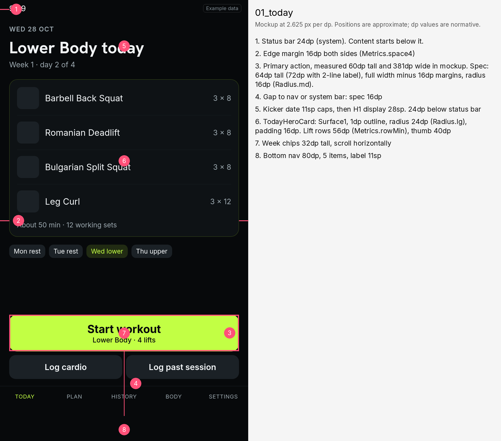

- Current capture: flow03_step01_tab-home
- Primary: Start workout (today_start_cta)
- Secondary: Log cardio, Log past session, tap a lift (opens preview), week chips
- Regions: Header (date kicker, H1, day subtitle); TodayHeroCard (lift list, time estimate); week chips; dock (primary and 2 secondary); bottom nav

| State | Spec |
|---|---|
| Empty | No plan: hero shows "No plan yet" and primary "Build your week" (today_build_week_cta). |
| Loading | ScreenLoading skeleton with 1 hero card (components/EmptyState.kt). |
| Error | Inline panel "Could not load today" and Try again (today_error_retry). |
| First time | After onboarding: hero shows plan day 1 with caption "Your first workout" (today_first_caption). |
| Resume | Session in progress: hero becomes "Workout in progress" and primary "Resume workout" (today_resume_cta). LiveSessionBar hidden on Today to avoid a duplicate. |
| Process death | State comes from DB flows (HomeViewModel); HomeDayMemory restores the selected day. |

| String id | Copy |
|---|---|
| today_kicker_date | {weekday} {day} {month} |
| today_title | {dayName} today |
| today_title_rest | Rest day |
| today_start_cta | Start workout |
| today_start_sub | {dayName} · {liftCount} lifts |
| today_resume_cta | Resume workout |
| today_in_progress | Workout in progress |
| today_log_cardio | Log cardio |
| today_log_past | Log past session |
| today_build_week_cta | Build your week |
| today_no_plan | No plan yet |
| today_error | Could not load today |
| today_error_retry | Try again |
| today_first_caption | Your first workout |
| today_train_anyway | Train anyway |
| today_estimate | About {minutes} min · {sets} working sets |

- In: App launch, bottom nav, Summary Done
- Out: Preview 06, Cardio live 17, Past session 16, Plan week 02
- Back: System back exits the app (existing)
- Edge cases: Rest day: H1 "Rest day", primary becomes secondary "Train anyway". Cardio-only day: list shows cardio type. Very long routine name: 2 lines then ellipsis. Landscape: hero and dock side by side (HomeBoardLayout).
- Files: home/HomeScreen.kt, home/DailyAgendaCard.kt, home/HomeBoardLayout.kt, home/DayBlock.kt, home/HomeStartSheet.kt, home/HomeViewModel.kt, home/HomeDayMemory.kt, navigation/AppNav.kt, navigation/LiveSessionBar.kt

### 4.2 Plan week (02_plan_week)

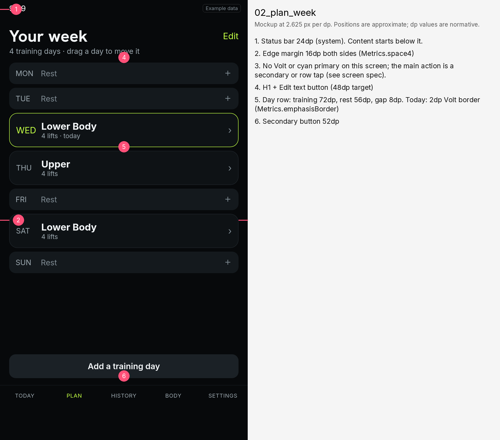

- Current capture: flow03_step02_tab-plan
- Primary: Tap a day (opens Plan day 03)
- Secondary: Edit, Add a training day, Library
- Regions: Header; 7 day rows (training 72dp, rest 56dp); dock secondary; bottom nav

| State | Spec |
|---|---|
| Empty | No week: "No week yet" and primary "Build the week" (opens CustomWeekScreen). |
| Loading | Header and skeleton rows. Today trunk renders PlanHeader and ScreenLoading, which matches the blank capture (see R0). |
| Error | Panel with PlanUiState.error and Try again. |
| First time | Suggested week from onboarding with caption "Suggested. Change anything." (plan_suggested_caption). |
| Resume | If a session is live, a row "Workout in progress" links to it. |
| Process death | PlanViewModel reloads from DB. |

| String id | Copy |
|---|---|
| plan_title | Your week |
| plan_subtitle | {count} training days |
| plan_edit | Edit |
| plan_add_day | Add a training day |
| plan_empty_title | No week yet |
| plan_empty_cta | Build the week |
| plan_rest | Rest |
| plan_today | today |
| plan_library | Library |
| plan_suggested_caption | Suggested. Change anything. |
| plan_live_row | Workout in progress |
| plan_error_retry | Try again |

- In: Bottom nav, Today "Build your week"
- Out: Plan day 03, CustomWeekScreen, Library
- Back: Back goes to Today tab (existing tab behaviour)
- Edge cases: Missed workouts: MissedWorkCard stays above rows. Block review banner kept. Two routines on one day: row lists both names.
- Files: plan/PlanScreen.kt, plan/PlanViewModel.kt, plan/MissedWorkCard.kt, routines/CustomWeekScreen.kt, components/EmptyState.kt

### 4.3 Plan day (routine editor) (03_plan_day)

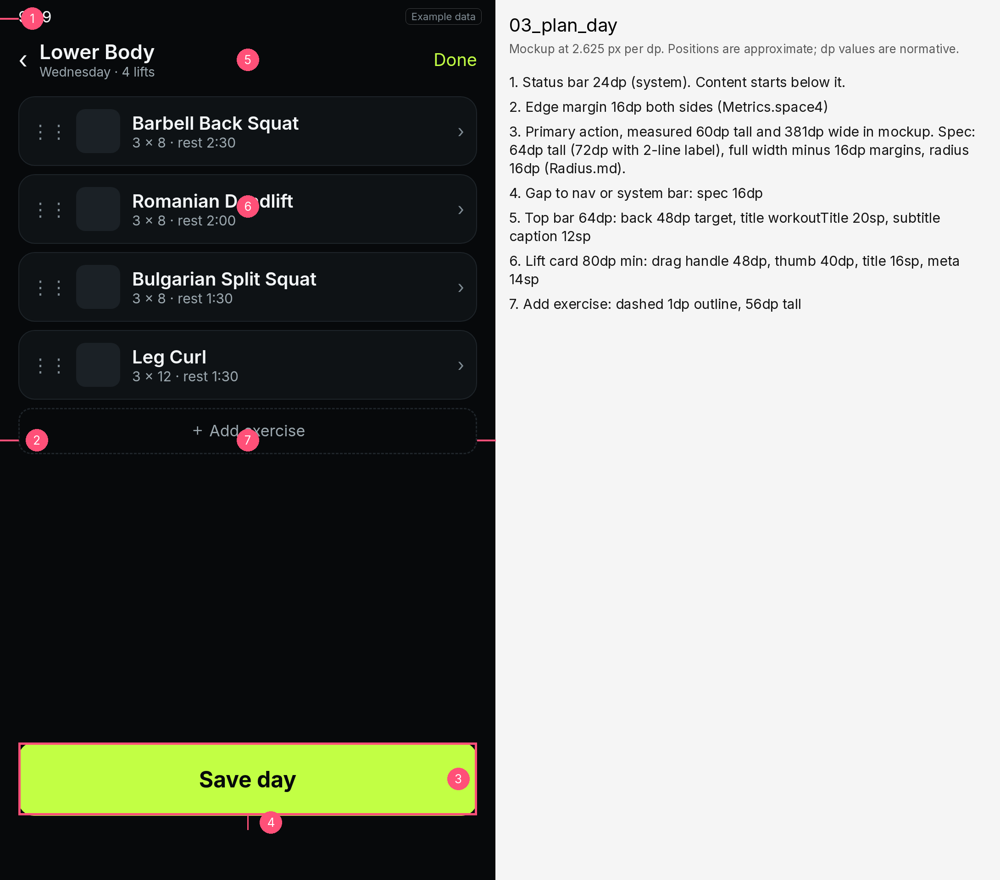

- Current capture: none (not captured)
- Primary: Save day (routine_save)
- Secondary: Reorder (D14), open a lift, Add exercise, back
- Regions: Top bar; lift cards (handle, thumb, name, targets); add row; dock

| State | Spec |
|---|---|
| Empty | "Add your first lift" panel with Add exercise primary. |
| Loading | Skeleton cards (RoutineEditorUiState.isLoading). |
| Error | saveError inline with Try again; missing routine: existing "Routine missing" panel. |
| First time | Same as empty. |
| Resume | Unsaved edits restored with banner "Resumed unfinished edits" (existing RoutineRecoveryState). |
| Process death | SavedStateHandle drafts (existing RoutineRecoveryState). |

| String id | Copy |
|---|---|
| routine_subtitle | {weekday} · {count} lifts |
| routine_add_exercise | Add exercise |
| routine_add_first | Add your first lift |
| routine_save | Save day |
| routine_resumed | Resumed unfinished edits |
| routine_unsaved_title | Unfinished edits |
| routine_unsaved_keep | Keep editing |
| routine_unsaved_discard | Discard changes |
| routine_missing | Routine missing |
| routine_try_again | Try again |

- In: Plan week 02
- Out: Add exercise 04, Set targets 05, Plan week 02
- Back: Back with edits opens the existing unsaved dialog (RoutineExitOutcome.Unsaved)
- Edge cases: Very long lift name: 2 lines then ellipsis. Hold lifts show seconds. Bodyweight shows "BW". Reorder: RoutineExerciseEntity.sortOrder already exists and the editor already reorders (ERR_REORDER in RoutineEditorViewModel.kt); no migration.
- Files: routines/RoutineEditorScreen.kt, routines/RoutineEditorViewModel.kt, routines/RoutineEditorWrites.kt, routines/RoutineRecoveryState.kt

### 4.4 Add exercise (picker) (04_picker)

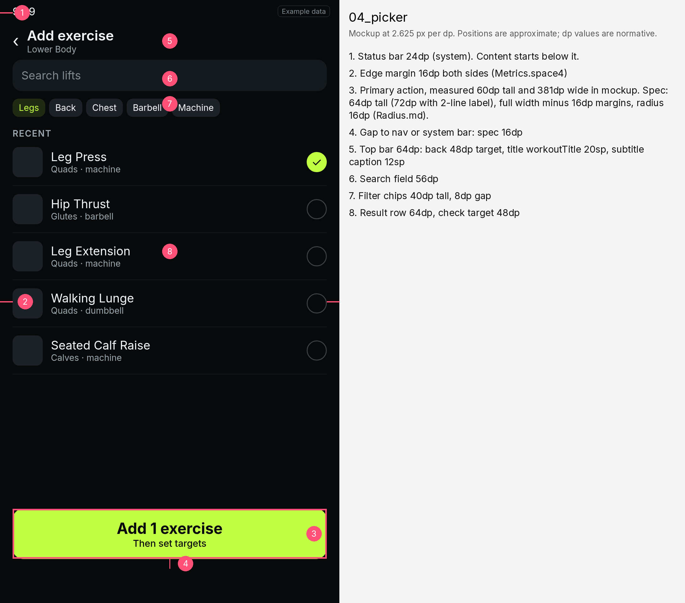

- Current capture: none (not captured)
- Primary: Add N exercises (picker_add_n)
- Secondary: Search, filter chips, Create lift, back
- Regions: Top bar; search; filter chips; Recent and results with check targets; dock

| State | Spec |
|---|---|
| Empty | No results: "No lifts match", Clear filters, Create lift. |
| Loading | ExercisePickerProgress busy: skeleton rows. |
| Error | Inline error row with Try again (existing PickerViewRecovery). |
| First time | Recent hidden; Suggested for the day shown. |
| Resume | Picked ids restored (RoutineEditorUiState.pickedIds). |
| Process death | Existing OwnedPickerRecovery. |

| String id | Copy |
|---|---|
| picker_title | Add exercise |
| picker_search_hint | Search lifts |
| picker_recent | Recent |
| picker_suggested | Suggested |
| picker_add_n | Add {count} exercise (plural: Add {count} exercises) |
| picker_add_sub | Then set targets |
| picker_none | No lifts match |
| picker_clear | Clear filters |
| picker_create | Create lift |
| picker_try_again | Try again |

- In: Plan day 03, live swap (11)
- Out: Set targets 05, back
- Back: Back keeps the selection draft until confirm (existing)
- Edge cases: Multi-select already exists (ExercisePickerSheet multiSelect). Swap mode is single select with swapSiblings pinned.
- Files: components/ExercisePickerSheet.kt, components/OwnedPickerRecovery.kt, components/PickerViewRecovery.kt, library/ExerciseLibraryScreen.kt, routines/RoutineEditorViewModel.kt

### 4.5 Set targets sheet (05_targets)

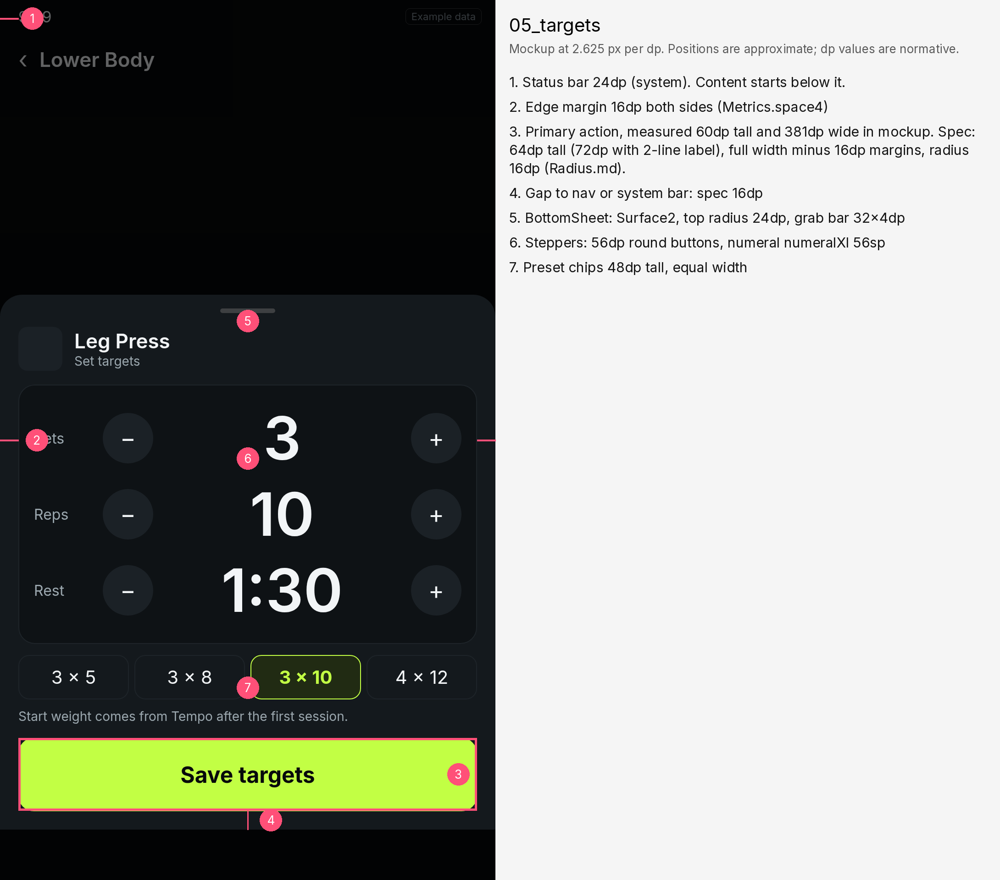

- Current capture: none (not captured)
- Primary: Save targets (targets_save)
- Secondary: Steppers, presets, swipe down
- Regions: BottomSheet: lift header; Sets, Reps, Rest steppers; preset chips; note; primary

| State | Spec |
|---|---|
| Empty | n/a, always prefilled from AddDefaults. |
| Loading | Primary loading while saving. |
| Error | Inline field message (RoutineNumberEntries). |
| First time | Defaults from domain/AddDefaults.kt. |
| Resume | Values kept in SavedStateHandle (NEW key). |
| Process death | Restored from SavedStateHandle. |

| String id | Copy |
|---|---|
| targets_subtitle | Set targets |
| targets_sets | Sets |
| targets_reps | Reps |
| targets_seconds | Seconds |
| targets_rest | Rest |
| targets_note | Start weight comes from Tempo after the first session. |
| targets_save | Save targets |

- In: Picker 04, tap lift in Plan day 03
- Out: Plan day 03
- Back: Back or swipe down discards sheet edits, no confirm
- Edge cases: Hold lift: Reps becomes Seconds. Rep ranges: INFERRED, check RoutineNumberEntries before R5.
- Files: routines/RoutineNumberEntries.kt, routines/RoutineEditorScreen.kt, NEW routines/TargetsSheet.kt

### 4.6 Pre-workout preview (06_preview)

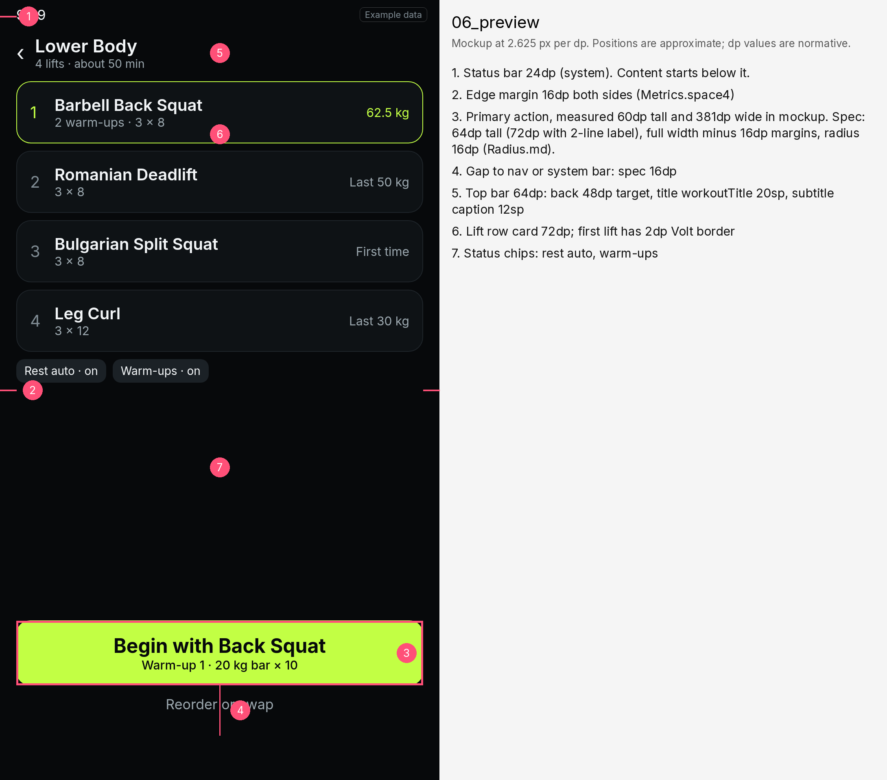

- Current capture: flow02_step03_onboarding-accepted-home
- Primary: Begin with {firstLift} (preview_begin)
- Secondary: Reorder or swap, back
- Regions: Top bar; numbered lift cards with start weight; status chips; dock

| State | Spec |
|---|---|
| Empty | Routine with 0 lifts: primary "Add a lift" (preview_add_lift). |
| Loading | Skeleton cards while ProgressionHint loads. |
| Error | Hint unavailable: "Last {weight}" or "First time"; never blocks. |
| First time | "First time" on every lift. |
| Resume | Not shown if a session is live; Today goes to Resume. |
| Process death | Stateless; rebuilt from routine. |

| String id | Copy |
|---|---|
| preview_subtitle | {count} lifts · about {minutes} min |
| preview_begin | Begin with {liftName} |
| preview_begin_sub | Warm-up 1 · {target} |
| preview_begin_sub_working | Set 1 · {target} |
| preview_reorder | Reorder or swap |
| preview_first_time | First time |
| preview_last | Last {weight} |
| preview_add_lift | Add a lift |

- In: Today 01, History detail Repeat
- Out: Live set 07 or 08
- Back: Back to Today; nothing created (session starts on Begin)
- Edge cases: NEW screen. Today the start sheet creates the session at once; Begin must call the same start path. D6.
- Files: workout/StartOptionsSheet.kt, workout/StartOptionsViewModel.kt, NEW workout/WorkoutPreviewScreen.kt, navigation/AppNav.kt

### 4.7 Live set, warm-up (07_live_warmup)

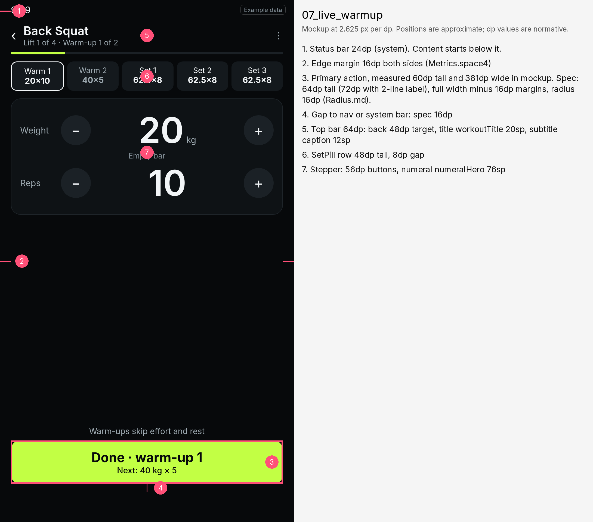

- Current capture: flow04_step01_strength-live-entry
- Primary: Done, warm-up N (live_warmup_done)
- Secondary: Steppers, Skip warm-ups (overflow), set pills
- Regions: Top bar with progress; SetPill row; stepper panel; caption; dock

| State | Spec |
|---|---|
| Empty | Session with no lifts: existing empty floor, primary "Add exercise". |
| Loading | SessionLoadState.LOADING: skeleton. MISSING: "Workout not found" and Back. FAILED: Try again (existing). |
| Error | WorkoutSavePhase FAILED or CONFLICT: primary becomes "Retry save" or "Review save" (existing in WorkoutPrimaryAction.kt). |
| First time | First session of a lift: no last values, effort not prefilled, TempoLine hidden if suggestionUnavailable. |
| Resume | Reopen from notification or LiveSessionBar: pendingResumeDraft restores draft; pills show saved sets. |
| Process death | FloorPrivateDrafts and FloorUndoOffers checkpoint restore draft and undo stack (existing). |

| String id | Copy |
|---|---|
| live_subtitle_warmup | Lift {i} of {n} · Warm-up {w} of {wn} |
| live_warmup_caption | Warm-ups skip effort and rest |
| live_warmup_done | Done · warm-up {n} |
| live_next_sub | Next: {target} |
| live_skip_warmups | Skip warm-ups |
| live_not_found | Workout not found |

- In: Preview 06
- Out: Next warm-up or Working set 08
- Back: Back keeps the workout running (WorkoutExit.Kept); LiveSessionBar shows
- Edge cases: Code: warm-ups never start rest (RestTimer.shouldStartAfterLog) and need no effort (SetLogRules.requiresEffort). Auto warm-up generation is unknown; D9.
- Files: workout/ActiveWorkoutScreen.kt, workout/ExerciseHeader.kt, workout/WorkoutHeader.kt, workout/WorkoutPrimaryAction.kt, workout/SetHistoryStrip.kt, workout/WorkoutDock.kt

### 4.8 Live set, working (08_live_working)

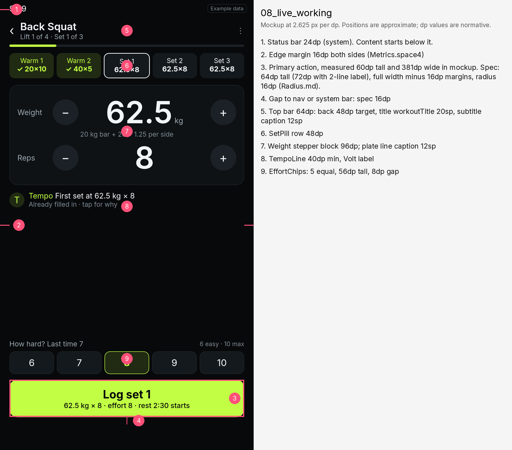

- Current capture: flow04_step02_strength-set-1-logged
- Primary: Log set N (live_log_set)
- Secondary: Steppers, effort chips, TempoLine, set pills, overflow
- Regions: Top bar; SetPill row; stepper panel (weight, plate line, reps); TempoLine; dock (EffortChips and primary)

| State | Spec |
|---|---|
| Empty | Session with no lifts: existing empty floor, primary "Add exercise". |
| Loading | SessionLoadState.LOADING: skeleton. MISSING: "Workout not found" and Back. FAILED: Try again (existing). |
| Error | WorkoutSavePhase FAILED or CONFLICT: primary becomes "Retry save" or "Review save" (existing in WorkoutPrimaryAction.kt). |
| First time | First session of a lift: no last values, effort not prefilled, TempoLine hidden if suggestionUnavailable. |
| Resume | Reopen from notification or LiveSessionBar: pendingResumeDraft restores draft; pills show saved sets. |
| Process death | FloorPrivateDrafts and FloorUndoOffers checkpoint restore draft and undo stack (existing). |

| String id | Copy |
|---|---|
| live_subtitle_working | Lift {i} of {n} · Set {s} of {sn} |
| live_effort_label | How hard? |
| live_effort_last | Last time {rpe} |
| live_effort_scale | 6 easy · 10 max |
| live_effort_missing | Pick an effort |
| live_log_set | Log set {n} |
| live_log_sub | {weight} × {reps} · effort {rpe} · rest {rest} starts |
| live_log_sub_last | {weight} × {reps} · effort {rpe} |
| live_bw | BW |
| tempo_label | Tempo |
| tempo_applied | Already filled in · tap for why |
| tempo_undo | Undo |

- In: Warm-up 07, Rest 09, Tempo 10, Between lifts 12
- Out: Rest 09; What next 11 after the last set
- Back: Back keeps the workout running (WorkoutExit.Kept)
- Edge cases: 0 kg working weight is rejected (SetLogRules ZERO_WORKING_WEIGHT) unless load type allows it. LoadType BODYWEIGHT shows "BW"; BODYWEIGHT_PLUS shows added kg; ASSISTED shows assist kg; STACK uses pin steps. Hold lifts: reps become seconds, effort hidden. Unilateral: no per-side logging found, not designed (ASSUMPTION). Supersets: none in code. Landscape: LandscapeChrome keeps steppers left and dock right.
- Files: workout/ActiveWorkoutScreen.kt, workout/ActiveWorkoutViewModel.kt, workout/WorkoutDock.kt, workout/WeightRepsEditor.kt, workout/RpeSelector.kt, workout/FocusEffortChoice.kt, workout/WorkoutReadiness.kt, workout/WorkoutPrimaryAction.kt, workout/TempoCoachCard.kt, workout/SetHistoryStrip.kt, workout/LandscapeChrome.kt

### 4.9 Rest state (09_rest)

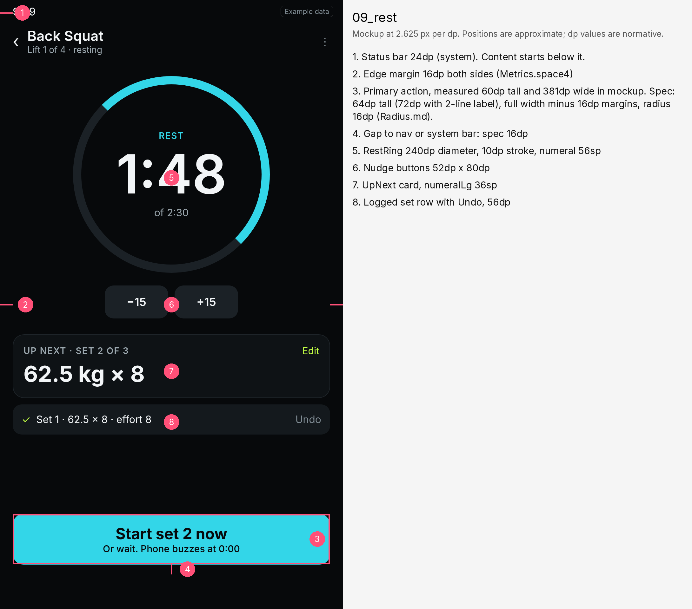

- Current capture: flow04_step03_strength-rest-after-set-1
- Primary: Start set N now (rest_start_now)
- Secondary: -15, +15, Edit up next, Undo last set
- Regions: Top bar; RestRing; nudge row; UpNextCard; logged row with Undo; dock (RestCyan primary)

| State | Spec |
|---|---|
| Empty | n/a. |
| Loading | Ring renders from RestTimerUiState at once; up next shimmers until the hint loads. |
| Error | Existing message "Set saved. Timer or feedback could not update." as toast; screen returns to set entry. |
| First time | Caption "Phone buzzes at 0:00" for the first 3 sessions (D13). |
| Resume | Reopen mid-rest: ring resumes from RestTimerController (existing). |
| Process death | Rest end stored in RestTimerController; restored (existing). |

| String id | Copy |
|---|---|
| rest_kicker | Rest |
| rest_of_total | of {total} |
| rest_minus | −15 |
| rest_plus | +15 |
| rest_up_next | Up next · set {s} of {sn} |
| rest_edit | Edit |
| rest_start_now | Start set {n} now |
| rest_start_sub | Or wait. Phone buzzes at 0:00 |
| rest_logged_row | Set {n} · {weight} × {reps} · effort {rpe} |
| rest_go | Go |
| rest_saved_toast | Set saved |

- In: Working set 08 (auto after Log set)
- Out: Working set 08
- Back: Back keeps running; rest continues in overlay and notification
- Edge cases: Overtime counts up in Warn. Rest off in settings: skip state, toast "Set saved". Last working set: no rest unless RestTimer.shouldStartAfterExtra; go to What next 11.
- Files: workout/RestTimerCard.kt, workout/RestCommands.kt, workout/RestTimerViewModel.kt, components/RestTimerUi.kt, workout/ActiveWorkoutScreen.kt, NEW components/UpNextCard.kt

### 4.10 Tempo suggestion sheet (10_tempo)

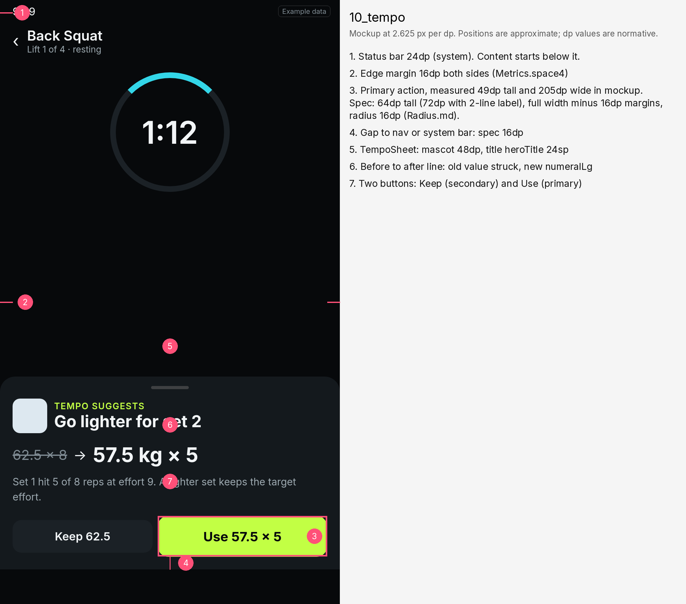

- Current capture: flow04_step07_strength-set-lift2-1-logged
- Primary: Use {target} (tempo_use)
- Secondary: Keep current, dismiss
- Regions: Small rest ring behind; TempoSheet

| State | Spec |
|---|---|
| Empty | No tip: sheet never opens. |
| Loading | Use button loading while the draft updates. |
| Error | Toast "Could not apply. Values unchanged." |
| First time | Intro line once: "Tempo suggests changes between sets." |
| Resume | Sheet not restored after death; TempoLine shows the tip. |
| Process death | As resume. |

| String id | Copy |
|---|---|
| tempo_sheet_kicker | Tempo suggests |
| tempo_use | Use {target} |
| tempo_keep | Keep {current} |
| tempo_apply_failed | Could not apply. Values unchanged. |
| tempo_intro | Tempo suggests changes between sets. |

- In: Rest 09 (auto, rule D5)
- Out: Rest 09 then Working set 08
- Back: Back or swipe equals Keep
- Edge cases: Only opens when the tip changes weight or reps of the next set. Add-a-set tips (AddASetPolicy) appear in What next 11.
- Files: workout/TempoCoachCard.kt, workout/TempoWhySheet.kt, workout/TempoCoachInputs.kt, workout/NextSetRecommendation.kt, workout/TempoCoachMascot.kt, NEW workout/TempoSheet.kt

### 4.11 What next sheet (11_set_options)

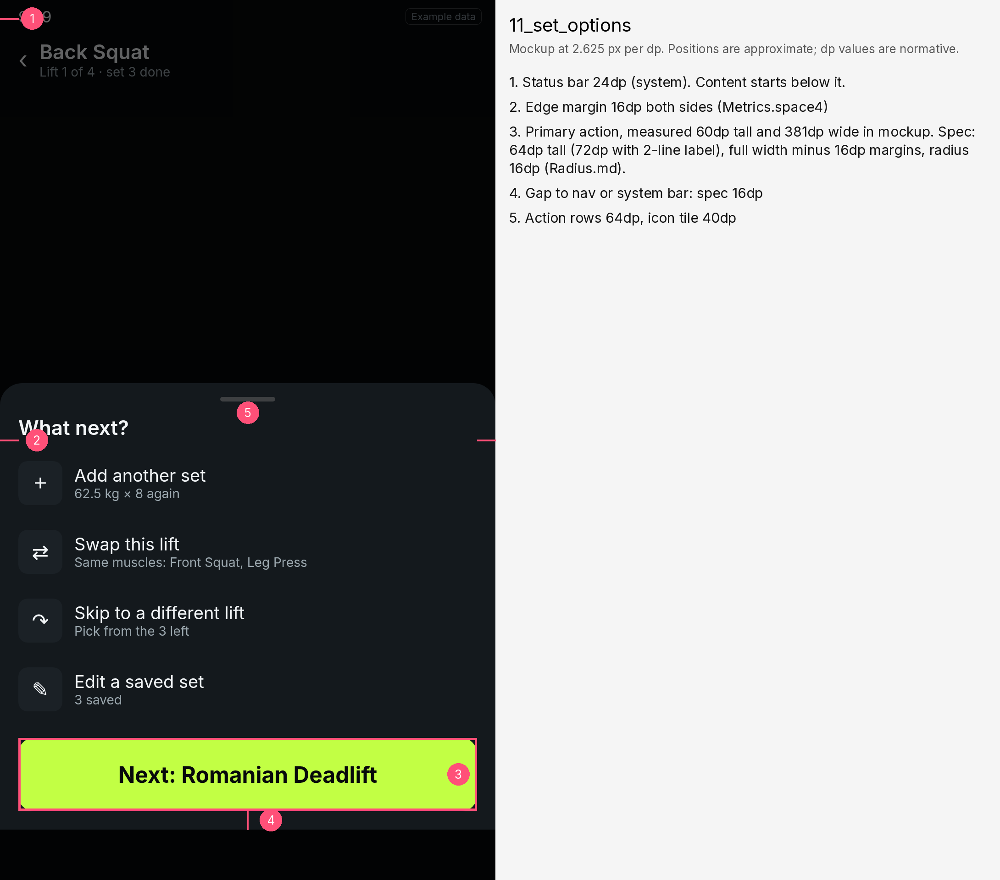

- Current capture: none (not captured)
- Primary: Next: {nextLift} (next_lift_cta)
- Secondary: Add another set, Swap, Skip to a lift, Edit a saved set
- Regions: BottomSheet with 4 action rows and primary

| State | Spec |
|---|---|
| Empty | Last lift: primary becomes "Finish workout". |
| Loading | Rows disabled while saving. |
| Error | Toast with existing save error. |
| First time | n/a. |
| Resume | After death the sheet is closed; set entry shows "Planned sets complete" and the primary. |
| Process death | As resume. |

| String id | Copy |
|---|---|
| next_title | What next? |
| next_add_set | Add another set |
| next_add_set_sub | {target} again |
| next_swap | Swap this lift |
| next_swap_sub | Same muscles: {siblings} |
| next_skip | Skip to a different lift |
| next_skip_sub | Pick from the {count} left |
| next_edit | Edit a saved set |
| next_lift_cta | Next: {liftName} |
| next_finish_cta | Finish workout |
| next_planned_done | Planned sets complete |

- In: Working set 08 after the last planned set
- Out: Between lifts 12, picker (swap), set edit
- Back: Back closes the sheet
- Edge cases: Replaces inline "Add another set", "Timers", "Next exercise" (flow04_step06) and the LiftSwitcherSheet entry.
- Files: workout/WorkoutSetOptionsSheet.kt, workout/LiftSwitcherSheet.kt, workout/WorkoutOverflowMenu.kt, workout/WorkoutPrimaryAction.kt

### 4.12 Between lifts (12_between)

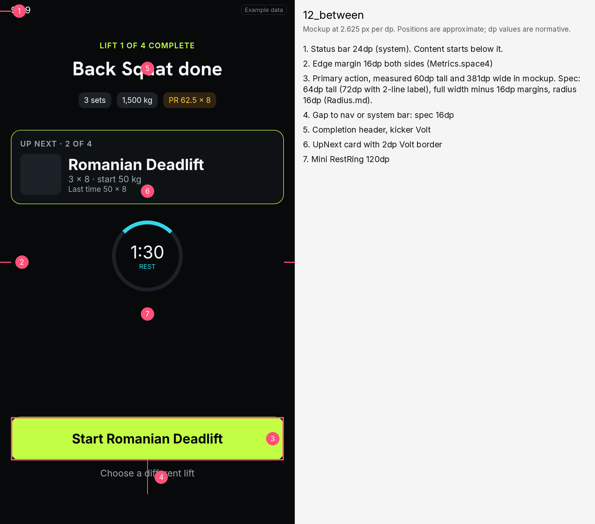

- Current capture: flow04_step06_strength-set-3-logged
- Primary: Start {nextLift} (between_start)
- Secondary: Choose a different lift
- Regions: Completion header with stat chips; UpNextCard (emphasis); mini RestRing; dock

| State | Spec |
|---|---|
| Empty | n/a. |
| Loading | Next lift hint shimmer. |
| Error | Hint unavailable: "Start {weight}" from plan target. |
| First time | Next lift first time: "First time, start light". |
| Resume | Restored as set entry of the next lift. |
| Process death | As resume. |

| String id | Copy |
|---|---|
| between_kicker | Lift {i} of {n} complete |
| between_title | {liftName} done |
| between_sets | {count} sets |
| between_volume | {kg} kg |
| between_pr | PR {value} |
| between_up_next | Up next · {i} of {n} |
| between_start | Start {liftName} |
| between_other | Choose a different lift |
| between_first_time | First time, start light |

- In: What next 11
- Out: Working set 08 (next lift)
- Back: Back returns to the finished lift
- Edge cases: PR chip only when PersonalRecordMoment exists. Rest keeps running (D10).
- Files: workout/ActiveWorkoutScreen.kt, workout/WorkoutPrimaryAction.kt, NEW workout/LiftTransitionPanel.kt

### 4.13 Finish confirm (13_finish)

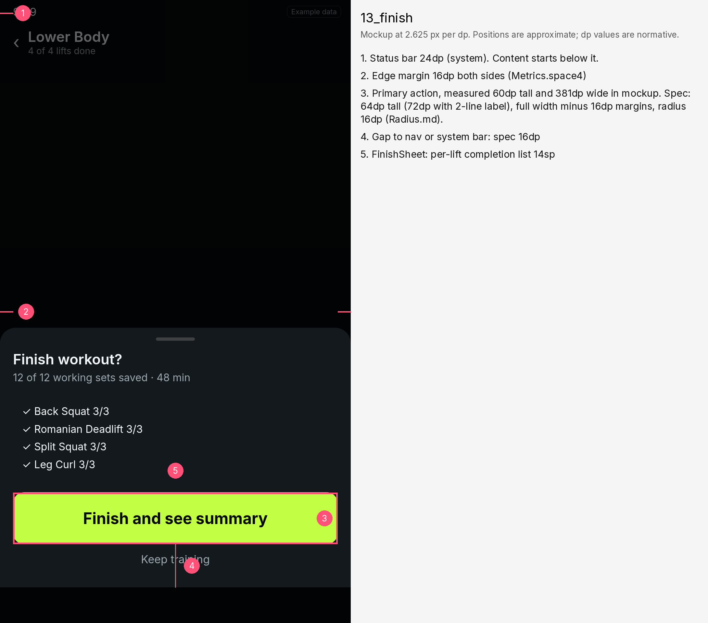

- Current capture: none (not captured)
- Primary: Finish and see summary (finish_cta)
- Secondary: Keep training
- Regions: BottomSheet: title, counts, per-lift list, primary, ghost

| State | Spec |
|---|---|
| Empty | 0 sets: Destructive "Discard workout" instead (existing showDiscard). |
| Loading | Primary loading while finishing. |
| Error | Inline error and Try again. |
| First time | n/a. |
| Resume | n/a. |
| Process death | Sheet closed; nothing lost. |

| String id | Copy |
|---|---|
| finish_title | Finish workout? |
| finish_counts | {done} of {planned} working sets saved · {minutes} min |
| finish_cta | Finish and see summary |
| finish_keep | Keep training |
| finish_discard | Discard workout |
| finish_incomplete | {count} planned sets not done |
| finish_try_again | Try again |

- In: What next 11 (last lift), overflow
- Out: Summary 14
- Back: Back closes the sheet
- Edge cases: Open correction: existing guard must still block (FinishWithOpenCorrectionRenderTest). Incomplete lifts shown with a muted dash.
- Files: workout/WorkoutOverflowMenu.kt, workout/WorkoutPrimaryAction.kt, components/EndWorkoutDialog.kt, NEW workout/FinishSheet.kt

### 4.14 Summary (14_summary)

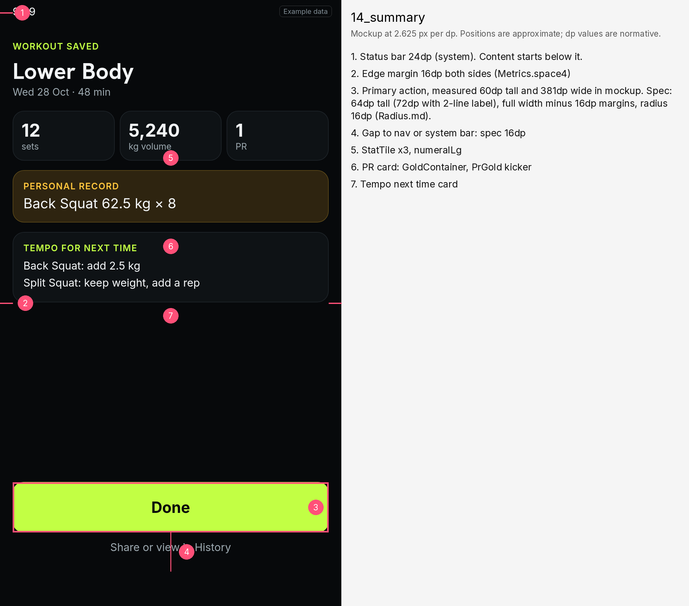

- Current capture: flow04_step10_strength-finished-summary (black capture)
- Primary: Done (summary_done)
- Secondary: View in History
- Regions: Saved kicker and title; 3 StatTiles; PR card; Tempo next-time card; dock

| State | Spec |
|---|---|
| Empty | hasWork false: existing empty copy. |
| Loading | ScreenLoading (existing); R0 checks whether this is the black capture. |
| Error | failed and missing flags (existing) with Back. |
| First time | "First workout saved" line. |
| Resume | n/a. |
| Process death | Reloads from DB by sessionId. |

| String id | Copy |
|---|---|
| summary_kicker | Workout saved |
| summary_sets | sets |
| summary_volume | kg volume |
| summary_prs | PR (plural: PRs) |
| summary_pr_kicker | Personal record |
| summary_tempo_kicker | Tempo for next time |
| summary_done | Done |
| summary_history | View in History |
| summary_first | First workout saved |

- In: Finish 13, Cardio 17
- Out: Today 01, History detail 15
- Back: Back equals Done (existing BackHandler)
- Edge cases: Tempo block only when progression has a change (D11). Cardio summary hides volume.
- Files: summary/WorkoutSummaryScreen.kt, summary/WorkoutSummaryViewModel.kt, components/GymSurfaces.kt

### 4.15 History detail (15_history_detail)

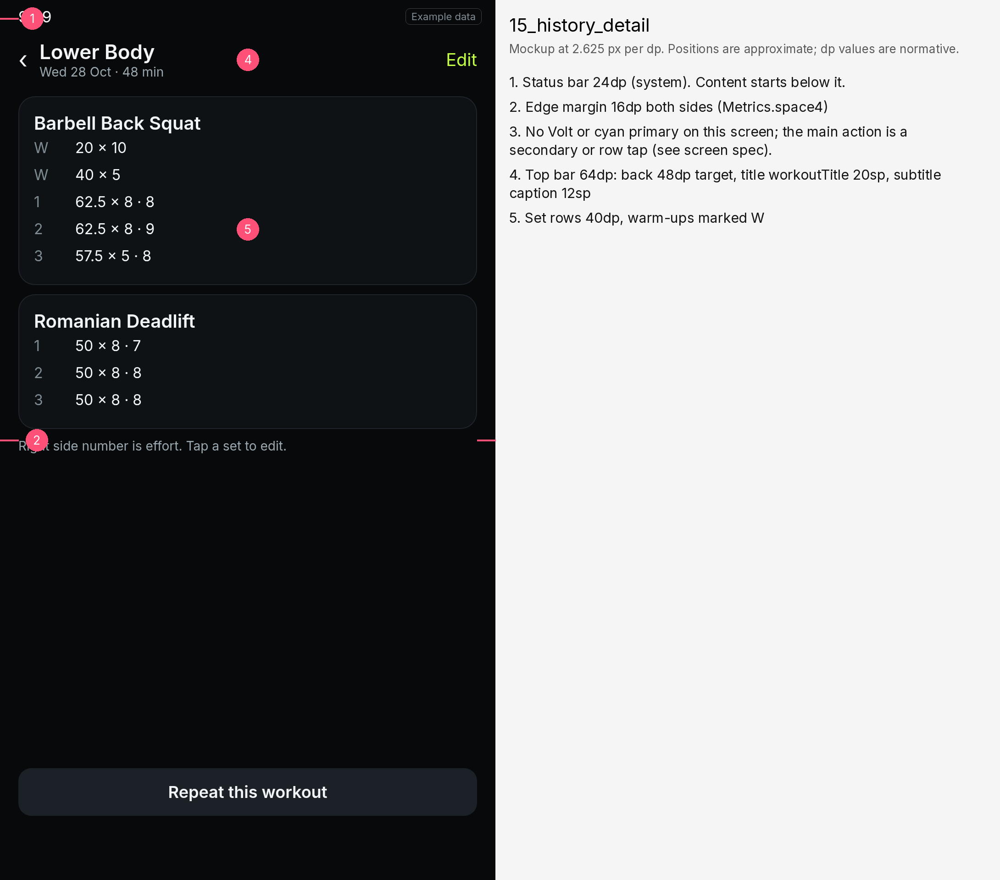

- Current capture: flow03_step04_tab-history
- Primary: Repeat this workout (history_repeat)
- Secondary: Edit, tap a set
- Regions: Top bar; lift cards with set rows; caption; dock

| State | Spec |
|---|---|
| Empty | n/a. |
| Loading | Skeleton. |
| Error | Existing SessionDetail error. |
| First time | n/a. |
| Resume | n/a. |
| Process death | Reload. |

| String id | Copy |
|---|---|
| history_detail_subtitle | {date} · {minutes} min |
| history_edit | Edit |
| history_effort_hint | Right side number is effort. Tap a set to edit. |
| history_repeat | Repeat this workout |
| history_warmup_mark | W |

- In: History list
- Out: Preview 06 (Repeat), SetEditSheet
- Back: Back to History list
- Edge cases: Repeat is NEW and needs a start path (INFERRED none exists).
- Files: history/SessionDetailScreen.kt, history/SessionDetailViewModel.kt, history/SetEditSheet.kt, history/HistoryScreen.kt

### 4.16 Past-session logger (16_past_session)

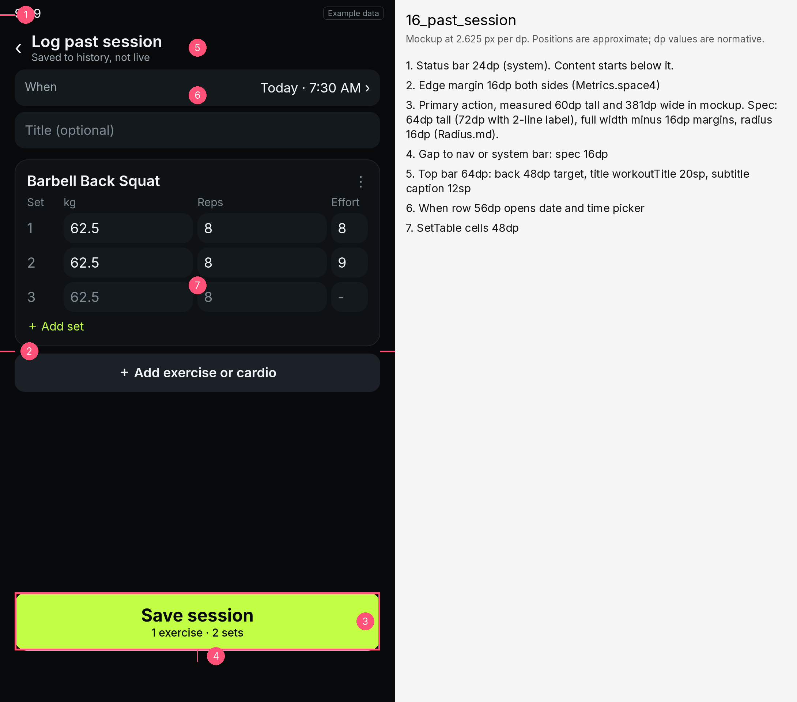

- Current capture: flow06_step02_mixed-composer-filled
- Primary: Save session (past_save)
- Secondary: When picker, Add set, Add exercise or cardio, overflow Discard
- Regions: Top bar; When row; Title; lift card with SetTable; add rows; dock

| State | Spec |
|---|---|
| Empty | Save disabled with sub-label "Add a lift or cardio". |
| Loading | Saving spinner. |
| Error | Field messages per cell; future time refused (existing rule). |
| First time | When defaults to today at noon (existing). |
| Resume | Draft restored (SavedStateComposerDraft). |
| Process death | Same. |

| String id | Copy |
|---|---|
| past_title | Log past session |
| past_subtitle | Saved to history, not live |
| past_when | When |
| past_title_hint | Title (optional) |
| past_add_set | Add set |
| past_add_more | Add exercise or cardio |
| past_save | Save session |
| past_save_sub | {lifts} exercise · {sets} sets |
| past_save_empty | Add a lift or cardio |
| past_discard | Discard draft |

- In: Today 01
- Out: History detail 15
- Back: Back keeps the draft and leaves; Discard only in overflow
- Edge cases: Replaces the Earlier / date / Later row with one When field.
- Files: activity/ActivityComposerScreen.kt, activity/ActivityComposerViewModel.kt, activity/SavedStateComposerDraft.kt, components/SetTable.kt

### 4.17 Cardio live (17_cardio)

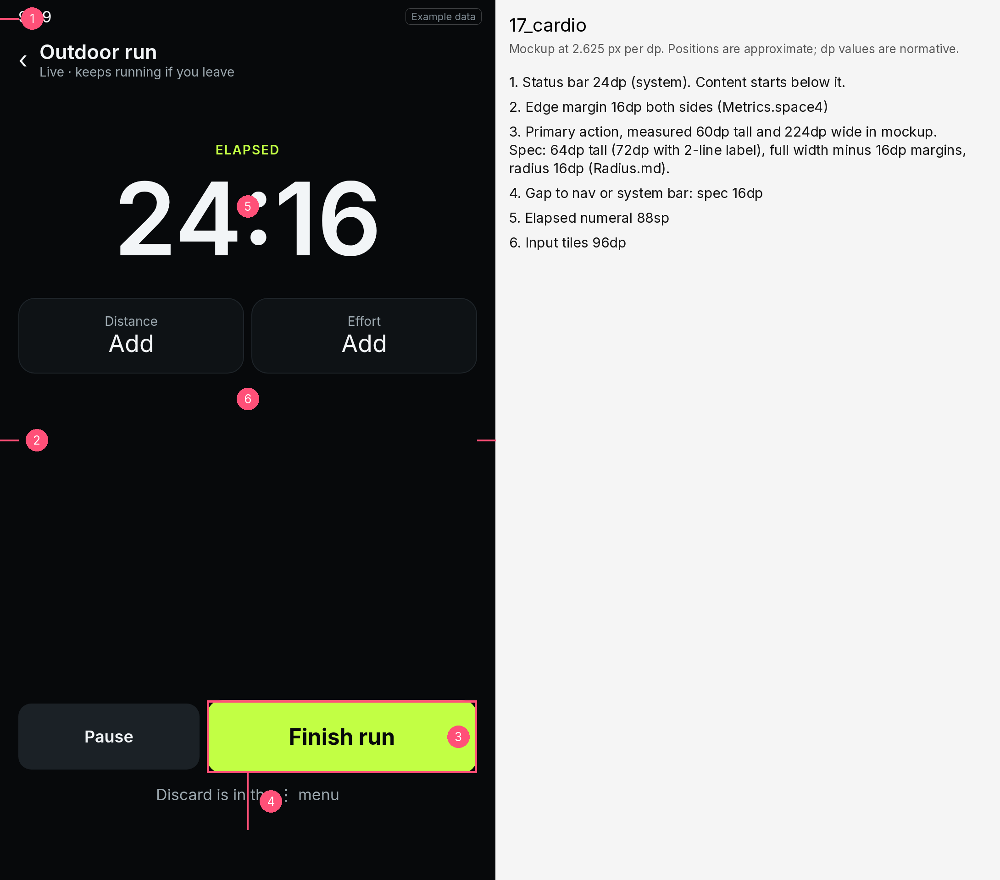

- Current capture: flow05_step02_cardio-live
- Primary: Finish {type} (cardio_finish)
- Secondary: Pause (D12), Distance, Effort, overflow Discard
- Regions: Top bar; elapsed numeral; input tiles; dock (Pause and Finish)

| State | Spec |
|---|---|
| Empty | Before 60 s: Finish disabled, sub-label "Available after 1 min". |
| Loading | n/a, local clock. |
| Error | Save fails: Try again. |
| First time | Type picker first (existing). |
| Resume | Clock survives leaving (existing LiveCardioViewModel). |
| Process death | SavedStateCardioDraft. |

| String id | Copy |
|---|---|
| cardio_elapsed | Elapsed |
| cardio_distance | Distance |
| cardio_effort | Effort |
| cardio_add | Add |
| cardio_pause | Pause |
| cardio_resume | Resume |
| cardio_finish | Finish {type} |
| cardio_finish_wait | Available after 1 min |
| cardio_discard_hint | Discard is in the menu |
| cardio_try_again | Try again |

- In: Today 01
- Out: Summary 14
- Back: Back opens LeaveCardioDialog (existing)
- Edge cases: Pause: INFERRED absent in LiveCardioViewModel; NEW behaviour, D12.
- Files: activity/LiveCardioScreen.kt, activity/LiveCardioViewModel.kt, components/LeaveCardioDialog.kt, activity/SavedStateCardioDraft.kt

### 4.18 Live set at font scale 1.3 (18_live_font13)

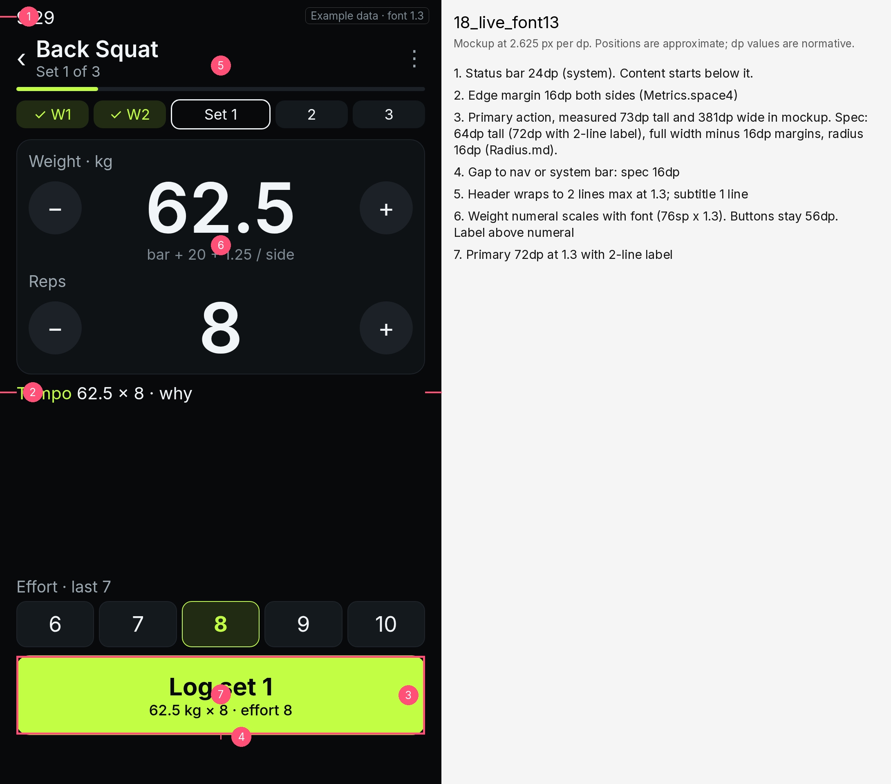

- Current capture: flow09_step01_strength-live-font-1-3
- Primary: Log set N (live_log_set)
- Secondary: Same as 08
- Regions: Same as 08 with reflow rules

| State | Spec |
|---|---|
| Empty | Session with no lifts: existing empty floor, primary "Add exercise". |
| Loading | SessionLoadState.LOADING: skeleton. MISSING: "Workout not found" and Back. FAILED: Try again (existing). |
| Error | WorkoutSavePhase FAILED or CONFLICT: primary becomes "Retry save" or "Review save" (existing in WorkoutPrimaryAction.kt). |
| First time | First session of a lift: no last values, effort not prefilled, TempoLine hidden if suggestionUnavailable. |
| Resume | Reopen from notification or LiveSessionBar: pendingResumeDraft restores draft; pills show saved sets. |
| Process death | FloorPrivateDrafts and FloorUndoOffers checkpoint restore draft and undo stack (existing). |

| String id | Copy |
|---|---|
| live_pill_short | Set {n} |
| live_warm_short | W{n} |

- In: Same as 08
- Out: Same as 08
- Back: Same as 08
- Edge cases: Rules: subtitle 1 line; pills show labels only; stepper label above numeral; numerals scale; TempoLine max 3 lines, no ellipsis on the target; dock grows; content above the dock scrolls (LogLoopBringIntoView keeps the stepper visible).
- Files: workout/ActiveWorkoutScreen.kt, workout/LogLoopBringIntoView.kt, theme/LogLoopScale.kt, theme/Type.kt

Edge cases for all strength screens: bodyweight shows BW, cardio uses screen 17, no plan uses the Today empty state, 0 kg rejected for external load, unilateral and supersets not supported (non-goal), long names wrap to 2 lines then ellipsis, landscape uses LandscapeChrome.

## 5. State machines

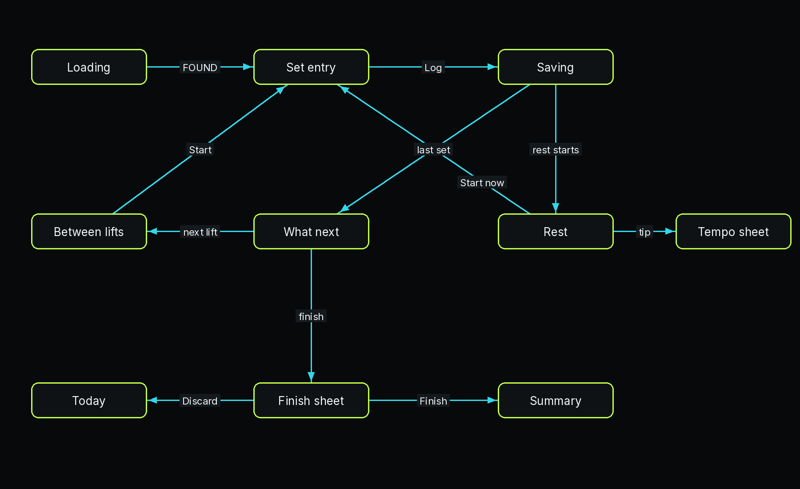

### Live session (ui/workout/ActiveWorkoutViewModel.kt)

| From | Event | To | Code |
|---|---|---|---|
| Loading | loadState FOUND | Set entry (warm-up or working) | ActiveWorkoutUiState.loadState |
| Loading | MISSING or FAILED | Missing or Failed panel | SessionLoadState |
| Set entry | Log tapped and logCommitReady | Saving | logSet() / WorkoutSavePhase.SAVING |
| Set entry | Log tapped, effort missing | Set entry with "Pick an effort" | effortMissingForCommit |
| Saving | saved, shouldStartAfterLog true | Rest | startRestAfterSet() |
| Saving | saved, last target set | What next sheet | RestTimer.shouldStartAfterLog false |
| Saving | saved, warm-up | Next set entry | isWarmup |
| Saving | error | Set entry with Retry save | WorkoutSavePhase FAILED or CONFLICT, retrySave() |
| Rest | Start now or ring done | Set entry | skipRest() |
| Rest | tip changes next target (D5) | Tempo sheet | TempoCoachTip |
| Tempo sheet | Use | Rest with updated UpNext | applyTempoCoachTip() |
| Tempo sheet | Keep or back | Rest | none |
| Any | Undo in window | Previous state | undoTopOffer() |
| What next | Add another set | Set entry (extra) | shouldStartAfterExtra |
| What next | Next lift | Between lifts | NEW LiftTransitionPanel |
| What next | Finish (last lift) | Finish sheet | canFinish |
| Between lifts | Start | Set entry of next lift | applySelection() |
| Finish sheet | Finish | Summary | finishWorkout(), WorkoutExit.Finished |
| Finish sheet | Discard (0 sets) | Today | discardWorkout(), WorkoutExit.Discarded |
| Any | Back | Leaves screen, session kept | WorkoutExit.Kept |

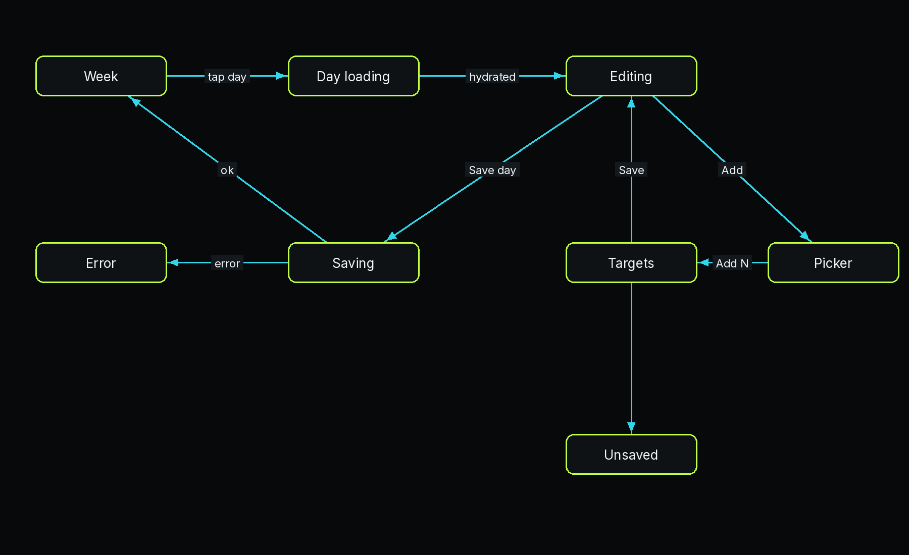

### Plan builder (PlanViewModel.kt, RoutineEditorViewModel.kt)

| From | Event | To | Code |
|---|---|---|---|
| Plan week Loading | loaded | Week list | PlanUiState.isLoading |
| Week list | tap day | Plan day Loading | AppNav route |
| Plan day Loading | hydrated | Editing | RoutineEditorUiState.isLoading, hydrate() |
| Editing | Add exercise | Picker | ExercisePickerSheet |
| Picker | Add N | Targets sheet | pickedIds |
| Targets sheet | Save targets | Editing | stageTargets(), commitTargets() |
| Editing | Save day | Saving | saveAndLeave(), saving |
| Saving | ok | Plan week | onExitHandled() |
| Saving | error | Editing with error | saveError |
| Editing | Back with edits | Unsaved dialog | leave(), unsavedOnBack |
| Unsaved dialog | Discard | Plan week | leaveAnyway() |
| Any | process death | Editing with Resumed banner | RoutineRecoveryState |

## 6. Behaviour rules

| Rule | Blueprint | Code today |
|---|---|---|
| Weight prefill | progression.suggestedWeightKg, then planned.targetWeightKg, then last time, then 0.0 | Code today: suggested, then planned target, then 0.0 (prefill() near line 1075). Last time is offered as applyLastTimeSet, not as a prefill. Blueprint keeps code order; "last time" is a chip only. |
| Reps prefill | planned targetReps, else 5; holds use seconds | Matches code (ActiveExerciseDraft reps 5). |
| Effort prefill | Last working set rpe of this lift in this session, else the last session, else none | NEW (D1). Code leaves rpe null. |
| Effort required | Working, non-hold sets | Matches SetLogRules.requiresEffort. |
| Zero weight | Rejected for working sets with an external load | Matches SetLogRules ZERO_WORKING_WEIGHT. |
| Undo window | STATUS_DWELL_MS 6 s scaled by system accessibility timeout; one offer stack | Matches FloorUndoOffers and UndoFeedback.systemUndoTimeout. |
| Rest auto-start | After a working set that is not the last target set | Matches RestTimer.shouldStartAfterLog. Extra sets follow shouldStartAfterExtra. Length from RestTimer.resolvePlan. |
| Tempo timing | TempoLine always when a tip exists; sheet per D5; applying is undoable | Code shows TempoCoachCard inline; sheet is NEW. |
| Finish validation | Blocked while a correction is open or while saving; 0 sets offers Discard | Matches canFinish, showDiscard and FinishWithOpenCorrectionRenderTest. |

## 7. Packets

Every packet: no checker baseline increase (tools/checker-baselines.toml), two green hosted gates, walkthrough screenshots refreshed. Walkthrough harness lives in PR 557, which is not in trunk; R0 depends on it.

### R0 Investigate blank Plan and black Summary captures

- Content: No product code until cause is known. Read PlanScreen.kt loading branch and WorkoutSummaryScreen.kt; rerun walkthrough harness (PR 557, not in trunk) with longer settle.
- Files touched: ui/plan/PlanScreen.kt, ui/summary/WorkoutSummaryScreen.kt, ui/components/EmptyState.kt
- New files: Probably none; a fix packet if a real bug
- Lanes and conflicts: Single lane
- Tests: PlanLoadsRenderTest (NEW) (NEW), SummaryRendersRenderTest (NEW) (NEW)
- Screenshots to update: flow03_step02_tab-plan, flow04_step10_strength-finished-summary
- Baselines: None
- Risk: Low. Risk: harness timing, not app
- Done when: Root cause written; both captures show content

### R1 Components and live set

- Content: Tokens (RestContainer), PrimaryButton, SetPill, EffortChips, ValueStepper, TempoLine; live set 07, 08, 18; effort prefill D1; strings
- Files touched: ui/theme/Color.kt, ui/components/GymButtons.kt, ui/workout/SetHistoryStrip.kt, ui/workout/RpeSelector.kt, ui/workout/WeightRepsEditor.kt, ui/workout/WorkoutDock.kt, ui/workout/ActiveWorkoutViewModel.kt, ui/workout/ActiveWorkoutScreen.kt, app/src/main/res/values/strings.xml
- New files: ui/components/ValueStepper.kt, ui/components/SetPill.kt
- Lanes and conflicts: Lane A components; Lane B VM prefill. Shared: ActiveWorkoutScreen.kt (Lane A only), strings.xml (append, rebase)
- Tests: EffortPrefillTest (NEW), SetPillRenderTest (NEW), EffortChipsRenderTest (NEW), LargeTextEntryRenderTest update, DockCommitRenderTest update
- Screenshots to update: flow04_step01..02, flow09_step01_strength-live-font-1-3
- Baselines: raw_dp and named_color must not rise; new tokens in theme
- Risk: Medium: dock layout tests
- Done when: All 08 and 18 acceptance items pass; baselines flat

### R2 Rest state and Tempo sheet

- Content: Rest 09 redesign, UpNextCard, TempoSheet, D4, D5, D13
- Files touched: ui/workout/RestTimerCard.kt, ui/components/RestTimerUi.kt, ui/workout/TempoCoachCard.kt, ui/workout/ActiveWorkoutScreen.kt
- New files: ui/components/UpNextCard.kt, ui/workout/TempoSheet.kt
- Lanes and conflicts: Lane A rest UI; Lane B Tempo sheet. Shared: ActiveWorkoutScreen.kt (Lane A)
- Tests: FloorCompactRestBarTest update, TempoSheetRenderTest (NEW), RestCompletionLayoutInstrumentedTest update
- Screenshots to update: flow04_step03, flow04_step07
- Baselines: motion must not rise (use Motion.kt)
- Risk: Medium: timer overlay
- Done when: Rest and Tempo items pass

### R3 What next, between lifts, finish and summary

- Content: Screens 11 to 14, D3, D10, D11
- Files touched: ui/workout/WorkoutSetOptionsSheet.kt, ui/workout/WorkoutPrimaryAction.kt, ui/workout/WorkoutOverflowMenu.kt, ui/summary/WorkoutSummaryScreen.kt
- New files: ui/workout/LiftTransitionPanel.kt, ui/workout/FinishSheet.kt
- Lanes and conflicts: Lane A sheets; Lane B summary
- Tests: FinishWithOpenCorrectionRenderTest keep green, WorkoutCompletionJourneyInstrumentedTest update, FinishSheetRenderTest (NEW)
- Screenshots to update: flow04_step04..06, flow04_step08..10
- Baselines: None
- Risk: Medium: finish guards
- Done when: Finish never bypasses guards

### R4 Today and preview

- Content: Screens 01 and 06, D6, D7
- Files touched: ui/home/HomeScreen.kt, ui/home/DailyAgendaCard.kt, ui/workout/StartOptionsSheet.kt, ui/navigation/AppNav.kt
- New files: ui/workout/WorkoutPreviewScreen.kt
- Lanes and conflicts: Lane A Today; Lane B preview and AppNav.kt
- Tests: PreviewBeginRenderTest (NEW), WorkoutEntryJourneyInstrumentedTest update
- Screenshots to update: flow03_step01, flow02_step03
- Baselines: None
- Risk: Medium: start path
- Done when: Begin starts exactly one session

### R5 Plan builder, past session, cardio, history

- Content: Screens 02 to 05, 15 to 17, D12, D14
- Files touched: ui/plan/PlanScreen.kt, ui/routines/RoutineEditorScreen.kt, ui/activity/ActivityComposerScreen.kt, ui/activity/LiveCardioScreen.kt, ui/history/SessionDetailScreen.kt
- New files: ui/routines/TargetsSheet.kt
- Lanes and conflicts: Lane A plan; Lane B logging, cardio, history
- Tests: TargetsSheetRenderTest (NEW), CardioFinishGateTest (NEW)
- Screenshots to update: flow03_step02, flow03_step04, flow05_step02, flow06_step02
- Baselines: None
- Risk: Medium: many screens
- Done when: All remaining items pass

## 8. Acceptance checklist

| Id | Item | Evidence | Packet |
|---|---|---|---|
| A01 | Plan tab shows content after load, never blank | screenshot flow03_step02_tab-plan + PlanLoadsRenderTest (NEW) | R0 |
| A02 | Summary screen renders, never black | screenshot flow04_step10_strength-finished-summary + SummaryRendersRenderTest (NEW) | R0 |
| A03 | Primary button is 64dp tall and full width minus 16dp | DockCommitRenderTest | R1 |
| A04 | Every tappable is at least 48dp | checker + LargeTextEntryRenderTest | R1 |
| A05 | Effort prefilled from the last working set, dotted | EffortPrefillTest (NEW) | R1 |
| A06 | Log stays disabled with "Pick an effort" when no effort and none prefilled | FirstWorkingSetRenderTest | R1 |
| A07 | Warm-ups show no effort chips and never start rest | screenshot flow04_step01 + ActiveWorkoutViewModelTest | R1 |
| A08 | Font scale 1.3: numerals scale, nothing truncated, Log visible | screenshot flow09_step01_strength-live-font-1-3 + LargeTextEntryRenderTest | R1 |
| A09 | Font scale 2.0: effort chips wrap to two rows | LargeTextEntryRenderTest | R1 |
| A10 | Set pills show done, now, next, warm-up | SetPillRenderTest (NEW) | R1 |
| A11 | No checker baseline increases | tools/checker-baselines.toml diff | R1-R5 |
| A12 | Rest primary uses RestCyan and says Start set N now | screenshot flow04_step03 + FloorCompactRestBarTest | R2 |
| A13 | Rest ring done turns Volt with holdDone haptic | RestCompletionLayoutInstrumentedTest | R2 |
| A14 | Tempo sheet opens only when next target changes | TempoSheetRenderTest (NEW) | R2 |
| A15 | Using Tempo can be undone within the undo window | FloorPacketGUndoTest | R2 |
| A16 | After the last planned set, What next sheet opens | screenshot flow04_step06 | R3 |
| A17 | Between lifts shows next lift and keeps rest running | screenshot flow04_step06 | R3 |
| A18 | Finish blocked while a correction is open | FinishWithOpenCorrectionRenderTest | R3 |
| A19 | Summary shows sets, volume, PRs; Tempo card only on change | screenshot flow04_step10 | R3 |
| A20 | Today primary is Start workout with day and lift count | screenshot flow03_step01_tab-home | R4 |
| A21 | Preview Begin creates exactly one session | PreviewBeginRenderTest (NEW) + WorkoutEntryJourneyInstrumentedTest | R4 |
| A22 | Plan day save handles back with unsaved edits | RoutineEditor tests | R5 |
| A23 | Past session uses one When field | screenshot flow06_step02 | R5 |
| A24 | Cardio Finish enabled only after 60 s | screenshot flow05_step02 + CardioFinishGateTest (NEW) | R5 |
| A25 | History detail shows warm-ups marked W and effort hint | screenshot flow03_step04 | R5 |
| A26 | All strings on touched screens come from strings.xml ids | lint grep in review | R1-R5 |
| A27 | Today: all six states implemented as specced | render test per state for 01_today | R4 |
| A28 | Plan week: all six states implemented as specced | render test per state for 02_plan_week | R5 |
| A29 | Plan day (routine editor): all six states implemented as specced | render test per state for 03_plan_day | R5 |
| A30 | Add exercise (picker): all six states implemented as specced | render test per state for 04_picker | R5 |
| A31 | Set targets sheet: all six states implemented as specced | render test per state for 05_targets | R5 |
| A32 | Pre-workout preview: all six states implemented as specced | render test per state for 06_preview | R4 |
| A33 | Live set, warm-up: all six states implemented as specced | render test per state for 07_live_warmup | R1 |
| A34 | Live set, working: all six states implemented as specced | render test per state for 08_live_working | R1 |
| A35 | Rest state: all six states implemented as specced | render test per state for 09_rest | R2 |
| A36 | Tempo suggestion sheet: all six states implemented as specced | render test per state for 10_tempo | R2 |
| A37 | What next sheet: all six states implemented as specced | render test per state for 11_set_options | R3 |
| A38 | Between lifts: all six states implemented as specced | render test per state for 12_between | R3 |
| A39 | Finish confirm: all six states implemented as specced | render test per state for 13_finish | R3 |
| A40 | Summary: all six states implemented as specced | render test per state for 14_summary | R3 |
| A41 | History detail: all six states implemented as specced | render test per state for 15_history_detail | R5 |
| A42 | Past-session logger: all six states implemented as specced | render test per state for 16_past_session | R5 |
| A43 | Cardio live: all six states implemented as specced | render test per state for 17_cardio | R5 |
| A44 | Live set at font scale 1.3: all six states implemented as specced | render test per state for 18_live_font13 | R1 |

## 9. Traceability

Finding labels paraphrase the v2 and v3 documents (ASSUMPTION: numbering added here).

| Finding | Fix | Screen | Packet |
|---|---|---|---|
| v2 F1 Log disabled with no explanation | Effort prefill plus "Pick an effort" | 08 | R1 |
| v2 F2 Plan tab blank | Investigate | 02 | R0 |
| v2 F3 Summary black | Investigate | 14 | R0 |
| v2 F4 Too many equal buttons in the dock | One primary per screen | 07, 08, 09 | R1 |
| v2 F5 Rest looks like set entry | RestCyan rest state | 09 | R2 |
| v2 F6 Tempo card pushes content | TempoLine and sheet | 08, 10 | R2 |
| v2 F7 Large text truncates | Reflow rules | 18 | R1 |
| v3 F1 Next lift unclear | What next and Between lifts | 11, 12 | R3 |
| v3 F2 Finish hidden | Finish sheet | 13 | R3 |
| v3 F3 No preview | Preview | 06 | R4 |
| v3 F4 Past-session date row | When field | 16 | R5 |
| v3 F5 Cardio finish too early | 60 s gate | 17 | R5 |
| v3 F6 Plan builder targets | Targets sheet | 05 | R5 |

## 10. Risks

- R0 cause unknown; Plan blank matches the loading branch (hypothesis), Summary black may be a capture issue.
- PR 557 harness not in trunk; screenshot names depend on it.
- ActiveWorkoutScreen.kt is a hotspot for R1 and R2; serialise those edits.
- Preview (R4) must reuse the single start path or it can create duplicate sessions.
- Cardio Pause may need storage; D12 defers it if so.
- Moving strings (D8) touches many files; append-only to strings.xml to limit conflicts.
